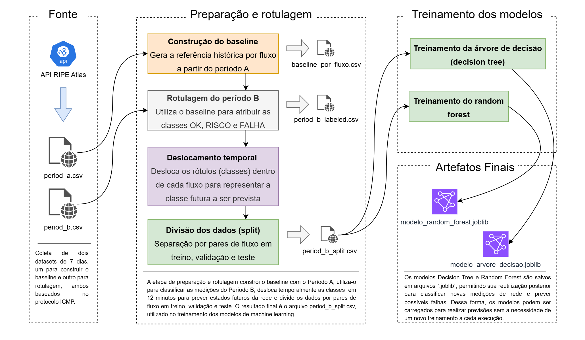

# NetPulse — Sistema de Monitoramento e Predição de Falhas em Redes
Sistema para monitoramento de métricas de rede com análise em tempo real e predição de falhas fazendo uso de árvore de decisão e usando como base de dados a RIPE Atlas API.

## 👨‍💻 Equipe e contexto acadêmico:

- Eduardo Gabriel de Souza Cardozo
- Gabriel Alves de Farias
- Gisele Franco de Lima
- Luigi Santos Caires
- Rodrigo de Souza Galvão

Esse projeto possui conexão com as seguintes disciplinas:

- Redes de Computadores
- Análise e Projeto de Sistemas
- Estrutura de Dados II

A metodologia adotada para esse projeto será a SCRUM

## 📑 Problemas e objetivos

O problema é identificar antecipadamente possíveis falhas de rede a partir de métricas de conectividade é um desafio. Busca-se investigar como dados reais de rede podem ser utilizados para identificar condições de risco por meio de aprendizado de máquina.

O objetivo é desenvolver um sistema de monitoramento e predição de falhas em redes utilizando dados da RIPE Atlas API.

- Coletar e processar medições de rede.
- Preparar e rotular datasets para modelagem.
- Treinar e avaliar modelos de Árvore de Decisão e Random Forest.
- Classificar condições futuras dos fluxos em OK, RISCO e FALHA.


## 🏗 Arquitetura do Sistema



O diagrama apresenta o fluxo completo do projeto, desde a coleta de medições da API do RIPE Atlas até o treinamento dos modelos de Machine Learning. O processo inclui a construção do baseline, a rotulagem e preparação dos dados, a divisão dos conjuntos e o treinamento dos algoritmos Decision Tree e Random Forest. Por fim, os modelos treinados são salvos em arquivos `.joblib`, permitindo sua reutilização para realizar previsões de possíveis falhas na rede.

## ⚙ Tecnologias utilizadas

| Tecnologia | Versão | Finalidade |
|---|---|---|
| [Python](https://www.python.org/) | — | Linguagem utilizada no desenvolvimento do pipeline e dos modelos de Machine Learning. |
| [Pandas](https://pandas.pydata.org/) | 3.0.3 | Manipulação, organização e análise dos dados em tabelas e arquivos CSV. |
| [Requests](https://requests.readthedocs.io/) | 2.34.2 | Realização de requisições HTTP para obtenção de dados da API do RIPE Atlas. |
| [NumPy](https://numpy.org/) | 2.5.1 | Operações numéricas e suporte ao processamento de dados. |
| [Scikit-learn](https://scikit-learn.org/) | 1.9.1 | Treinamento e avaliação dos modelos de Machine Learning Decision Tree e Random Forest. |
| [Joblib](https://joblib.readthedocs.io/) | 1.6.0 | Salvamento e carregamento dos modelos treinados em arquivos `.joblib`. |

As versões das bibliotecas estão fixadas para facilitar a reprodução do ambiente de desenvolvimento.
## Pipeline de dados

## Fluxo do Pipeline de Dados

### 1. Coleta de dados
As medições de rede são coletadas por meio da API do RIPE Atlas, utilizando probes de origem e anchors de destino definidos no projeto.

### 2. Geração dos datasets
Os dados coletados são organizados em dois conjuntos CSV, correspondentes a períodos consecutivos de sete dias: **Período A** e **Período B**.

### 3. Construção do baseline
O Período A é utilizado para calcular métricas históricas de referência para cada fluxo de rede, estabelecendo os parâmetros que serão utilizados na classificação das medições posteriores.

### 4. Rotulagem dos dados
As medições do Período B são classificadas com base no baseline histórico, recebendo os rótulos **OK**, **RISCO** ou **FALHA**, conforme as condições observadas na rede.

### 5. Deslocamento temporal dos rótulos
Os rótulos são deslocados temporalmente dentro de cada fluxo para que os modelos aprendam a prever a condição futura da rede a partir das medições disponíveis no momento atual.

### 6. Divisão do dataset
O dataset preparado é dividido em conjuntos de treinamento, validação e teste, mantendo os fluxos de origem e destino separados entre os conjuntos para reduzir o risco de vazamento de dados.

### 7. Treinamento dos modelos
Os dados são utilizados para treinar dois algoritmos de Machine Learning: **Decision Tree** e **Random Forest**, com o objetivo de prever possíveis condições futuras da rede.

### 8. Salvamento dos modelos
Após o treinamento, os modelos são salvos em arquivos `.joblib`, permitindo que sejam carregados posteriormente para realizar previsões sem a necessidade de treinar novamente.

## 💾 Modelos e resultados


Foram avaliados dois algoritmos de aprendizado de máquina: **Árvore de Decisão** e **Random Forest**, com ajuste de hiperparâmetros e avaliação em conjunto de teste com 12.518 registros.

| Métrica | Árvore de Decisão | Random Forest |
|---|---:|---:|
| Acurácia | 72,04% | **82,72%** |
| Macro F1-score | 0,555 | **0,630** |
| Recall — FALHA | 48,67% | **75,73%** |
| Recall — RISCO | **40,58%** | 22,51% |

O **Random Forest apresentou o melhor resultado geral**, com maior acurácia, Macro F1-score e capacidade de identificar a classe FALHA. Entretanto, ambos os modelos apresentaram dificuldades na classificação de RISCO, indicando oportunidades para melhorias na metodologia e no desempenho preditivo.

Os resultados e os metadados dos experimentos são utilizados para documentar os parâmetros selecionados e as métricas obtidas.

## Estrutura do Projeto

``` bash
netpulse-sistema-monitor-de-redes/
├── archive/                       # arquivos de dados inutilizados
├── data/                          
│   ├── interim/                   # contem dados referente ao dataset processado
│   ├── models/                    # contem metadados sobre os modelos
│   └── raw/                       # contem os datasets do período A e B, e metadados
├── docs/                          # contem a documentação do projeto
├── notebooks/                     # contem notebooks que foram usados durante a construção do projeto
├── src/                                   
│   ├── data_collection/           # contem os scripts relacionados a coleta e criação do cache
│   ├── data_labeling/             # contem os scripts relacionamos a rotulação dos dados
│   ├── data_model/                # contem os scripts do treinamento dos modelos
│   ├── etl_data_collection.py     # orquestrador da etapa de criação do cache
│   ├── etl_data_labeling.py       # orquestrador da etapa de rotulação
│   └── etl_data_model.py          # orquestrador do treinamento dos modelos
├── .gitignore          
├── LICENSE
├── main.py                        # arquivo de execução principal do projeto
└── README.md
```

## Como executar

## Limitações e próximos passos

### Limitações
- Desempenho limitado na classificação da classe RISCO.
- Necessidade de ampliar e diversificar os dados utilizados nos experimentos.
- Resultados ainda restritos aos dados e às condições avaliadas.

### Próximos passos
- Investigar estratégias para melhorar a classificação de RISCO.
- Explorar novos atributos e técnicas de engenharia de dados.
- Avaliar outros algoritmos e estratégias de ajuste de hiperparâmetros.
- Ampliar os testes com dados de diferentes períodos e fluxos de rede.
