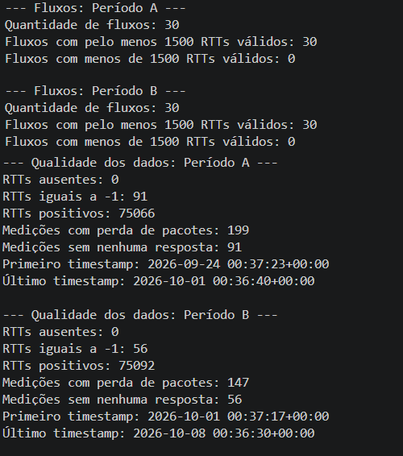

# Diário da Tarefa 2 — Baseline do fluxo e rotulagem OK, RISCO, FALHA

**Período:** 18/09/2026 a 30/09/2026  
**Projeto:** Preditor de degradação de rede com RTT normalizado (independente da rota)

**Equipe:** <br>
`Eduardo Gabriel de Souza Cardozo`<br> `Gabriel Alves de Farias`<br> `Gisele Franco de Lima`<br> `Luigi Santos Caires`<br> `Rodrigo de Souza Galvão`<br>
**Scrum Master da tarefa:** Rodrigo de Souza Galvão<br>
**Repositório GitHub:** `https://github.com/Rodrigo3441/netpulse-sistema-monitor-de-redes`

> Esta tarefa lê o `data/raw/` da Tarefa 1. Não troca a coleta sem versionar.
>
> O trabalho é **obter o baseline de cada fluxo e rotular o Período B** com a tabela desta página. A árvore não entra aqui. País, IP e rota não entram na tabela que a árvore vai ler.
>
> Ordem obrigatória: inspeção do bruto → ficha de baseline no Período A → métricas relativas no Período B → rótulo na ordem da tabela → só então o recorte temporal dentro de B.


### Contrato desta tarefa


|           | Artefato                                                              | Origem / destino                            |
| --------- | --------------------------------------------------------------------- | ------------------------------------------- |
| **Entra** | `data/raw/` e dicionário v0.1                                         | Tarefa 1                                    |
| **Sai**   | `baseline_por_fluxo.csv` (uma ficha por `fluxo_id`)                   | Tarefas 3 a 5                               |
| **Sai**   | Dataset rotulado do Período B, com a classe e as métricas abaixo      | Tarefa 3 **usa este arquivo e este rótulo** |
| **Sai**   | Recorte temporal dentro de B (treino mais antigo, teste mais recente) | Tarefas 3 a 5 — **o mesmo corte**           |
| **Sai**   | Dicionário v0.2 (bruto, ficha, métricas, classe, colunas proibidas)   | Tarefa 3                                    |


**Não sai daqui:** árvore treinada, profundidade escolhida, acurácia, F1.

- [X] O notebook lê o bruto da Tarefa 1

---


## 1. Inspeção do bruto (ainda sem rótulo)

`data/raw/` permanece intocado. A auditoria vai para o diário; a tabela de trabalho, para `data/interim/`.

- [X] Contagem de linhas, fluxos, duplicatas e RTT vazio
- [X] Nenhum RTT ausente foi gravado como 0
- [X] Período A e Período B não compartilham timestamp do mesmo fluxo

**N bruto:**  30 Fluxos
**N de fluxos:** 30 Fluxos<br>
**Evidências:**


## 2. Como obter o baseline

Uma ficha por `fluxo_id`. Só o Período A. O Período B não entra na conta e não atualiza a ficha.


| Passo | O que fazer                                                                                                            |
| ----- | ---------------------------------------------------------------------------------------------------------------------- |
| 1     | Separar o fluxo e ordenar pelo timestamp.                                                                              |
| 2     | Período A = bloco inicial. Período B = bloco seguinte, sem amostra nos dois.                                           |
| 3     | RTT válido = medição com RTT presente. Timeout fica **fora** da mediana e do MAD, e **dentro** do dataset como evento. |
| 4     | Menos de **1.500** RTT válidos no A: `baseline_insuficiente`. Esse fluxo **não** recebe classe. Não inventar mediana.  |
| 5     | Gravar uma linha em `baseline_por_fluxo.csv` e congelar.                                                               |


| Campo da ficha  | Fórmula, somente Período A                                 |
| --------------- | ---------------------------------------------------------- |
| `mediana`       | mediana dos RTT válidos (ms)                               |
| `MAD`           | mediana()                                                  |
| `jitter_tipico` | mediana do jitter nas medições em que o jitter existe (ms) |
| `perda_tipica`  | mediana de `perda_pct`, inclusive timeout (%)              |
| `prop_resposta` | medições com RTT válido / medições do período              |


- [X] Ficha conferida em pelo menos um fluxo curto e um fluxo longo (as medianas podem ser muito diferentes; as duas são “normal”)
- [X] Lista dos fluxos excluídos e o motivo (contagem abaixo de 1.500)

**Fluxos com ficha:**  Todos os 30 fluxos<br>
**Fluxos excluídos:**  Não houveram fluxos excluídos<br>


## 3. Métricas de cada medição do Período B

Calcular só com a ficha congelada daquele `fluxo_id`.


| Métrica           | Fórmula                                                                 |
| ----------------- | ----------------------------------------------------------------------- |
| `z_robusto`       | (RTT atual − mediana) / (1,4826 × MAD)                                  |
| `aumento_pct`     | (RTT atual − mediana) / mediana × 100                                   |
| `jitter_relativo` | jitter atual / `jitter_tipico`                                          |
| `perda_pct`       | (enviados − recebidos) / enviados × 100                                 |
| `timeout_atual`   | 1 se não há RTT ou `perda_pct` = 100; senão 0                           |
| `n5_timeout`      | timeouts nas últimas 5 medições deste fluxo, incluindo a atual (0 a 5)  |
| `n5_aumento80`    | quantas das últimas 5 têm `aumento_pct` > 80                            |
| `n5_risco`        | quantas das últimas 5 cumprem o critério da linha 5 da tabela de rótulo |


| Situação                               | Conta                                                                           |
| -------------------------------------- | ------------------------------------------------------------------------------- |
| RTT ausente                            | Não calcular `z_robusto` nem `aumento_pct`. `timeout_atual` = 1. Não usar 0 ms. |
| MAD = 0 e RTT atual = mediana          | `z_robusto` = 0                                                                 |
| MAD = 0 e RTT atual ≠ mediana          | Denominador = max(IQR / 1,349, 1 ms)                                            |
| Jitter atual vazio                     | O critério de jitter não dispara                                                |
| `jitter_tipico` = 0 e jitter atual = 0 | `jitter_relativo` = 1                                                           |
| `jitter_tipico` = 0 e jitter atual > 0 | Tratar como `jitter_relativo` ≥ 3                                               |


## 4. Tabela de rotulagem — parar na primeira linha verdadeira

Cada linha do Período B, de um fluxo que tenha ficha. FALHA ganha de RISCO; RISCO ganha de OK.


| Ordem | Classe    | Métrica                                                                                                   | Limiar exato                                        |
| ----- | --------- | --------------------------------------------------------------------------------------------------------- | --------------------------------------------------- |
| 1     | **FALHA** | `perda_pct`                                                                                               | ≥ 10 nesta medição (em 3 pacotes, 1 perda já é 33%) |
| 2     | **FALHA** | `n5_timeout`                                                                                              | ≥ 3                                                 |
| 3     | **FALHA** | `z_robusto`                                                                                               | ≥ 3,5 nesta medição, com RTT presente               |
| 4     | **FALHA** | `n5_aumento80`                                                                                            | ≥ 2                                                 |
| 5     | **RISCO** | nesta medição, pelo menos um: `2 ≤ z_robusto < 3,5`, ou `30 ≤ aumento_pct ≤ 80`, ou `jitter_relativo ≥ 3` | e `n5_risco` ≥ 2                                    |
| 6     | **OK**    | nenhuma linha anterior                                                                                    | pico isolado também é OK                            |


- [X] Três exemplos auditáveis no diário: um OK de caminho longo (RTT alto e `z_robusto` baixo), um RISCO, um FALHA de caminho curto ou de timeout
- [X] Contagem OK / RISCO / FALHA no Período B
- [X] A classe **não** foi definida por “RTT > 100 ms” nem pelo nome da rota
- [X] O Período A não foi rotulado
- [X] Dicionário v0.2 lista as colunas proibidas na árvore: país, IP, `rota_id`, `fluxo_id`, RTT absoluto como substituto das métricas relativas

**Três exemplos auditáveis:** [exemplos auditáveis](data_labeling/exemplos_auditaveis.md)

**Evidências (três linhas reais, com as métricas e a ordem que disparou a classe):**
``` bash
1227,84.88.18.254,6251,193.65.45.86,11863561,50.0,"[{'rtt': 64.776703}, {'rtt': 64.66692}, {'rtt': 64.615634}]",0,3,3,64.615634,64.776703,64.686419,1790815187,ping,3,240,65.21684400000001,0.1625981666666547,0.3345102500000081,0.1582399999999992,0.0,-0.813325158758078,-2.200312392382888,0,0.0805344999999988,0.5089389534883674,0,0,0,media,OK,nenhuma regra anterior satisfeita
1227,84.88.18.254,6251,193.65.45.86,11863561,50.0,"[{'rtt': 65.307114}, {'rtt': 65.270612}, {'rtt': 64.898268}]",0,3,3,64.898268,65.307114,65.15866466666667,1790815438,ping,3,240,65.21684400000001,0.1625981666666547,0.3345102500000081,0.1582399999999992,0.0,-0.0892090597535542,-0.2413398842700208,0,0.2044229999999984,1.2918541456016148,0,0,0,media,OK,nenhuma regra anterior satisfeita
1227,84.88.18.254,6251,193.65.45.86,11863561,50.0,"[{'rtt': 64.961661}, {'rtt': 65.369906}, {'rtt': 65.478981}]",0,3,3,64.961661,65.478981,65.27018266666667,1790815675,ping,3,240,65.21684400000001,0.1625981666666547,0.3345102500000081,0.1582399999999992,0.0,0.0817866419090465,0.2212597997074678,0,0.258659999999999,1.6346056622851386,0,0,0,media,OK,nenhuma regra anterior satisfeita
```

## 5. Recorte para a árvore (ainda sem treinar)

Dentro do Período B, por fluxo, em ordem de tempo:

- [X] Treino = trecho mais antigo; validação = trecho do meio; teste = trecho mais recente
- [X] Proporção de partida 80% / 10% / 10%, ajustada se um bloco ficar sem RISCO
- [X] Nenhum registro do Período A no treino
- [X] Corte com data e N de cada bloco

**Corte (datas e N treino / validação / teste):**

## 6. Scrum e diário

- [X] Board atualizado

**Link do board:**
[Quadro kanban](kanban.md)

| Integrante | O que fiz nesta tarefa | Dificuldades | O que pretendo manter/ajustar |
| ---------- | ---------------------- | ------------ | ----------------------------- |
| Rodrigo| fiz a construção dos scripts para rotulação dos dados| Visualizar o processo | ajustar a conexão com as próximas etapas|


---


## Rubrica — Tarefa 2 (0 a 4,0)


| Critério                  | Peso    | Nota máxima                                                                                     | Nota          | Observações |
| ------------------------- | ------- | ----------------------------------------------------------------------------------------------- | ------------- | ----------- |
| Baseline por fluxo        | 1,5     | Ficha só com o Período A, fórmulas desta página, piso de 1.500, exclusões listadas, A congelado |               |             |
| Rotulagem                 | 1,5     | Tabela aplicada na ordem, exemplos curto/longo, timeout sem RTT = 0, contagem das três classes  |               |             |
| Independência da rota     | 0,5     | Rota e RTT absoluto fora do rótulo e fora das colunas da futura árvore                          |               |             |
| Recorte temporal + diário | 0,5     | Corte dentro de B, com N; diário de todos                                                       |               |             |
| **Total**                 | **4,0** |                                                                                                 | **___ / 4,0** |             |


